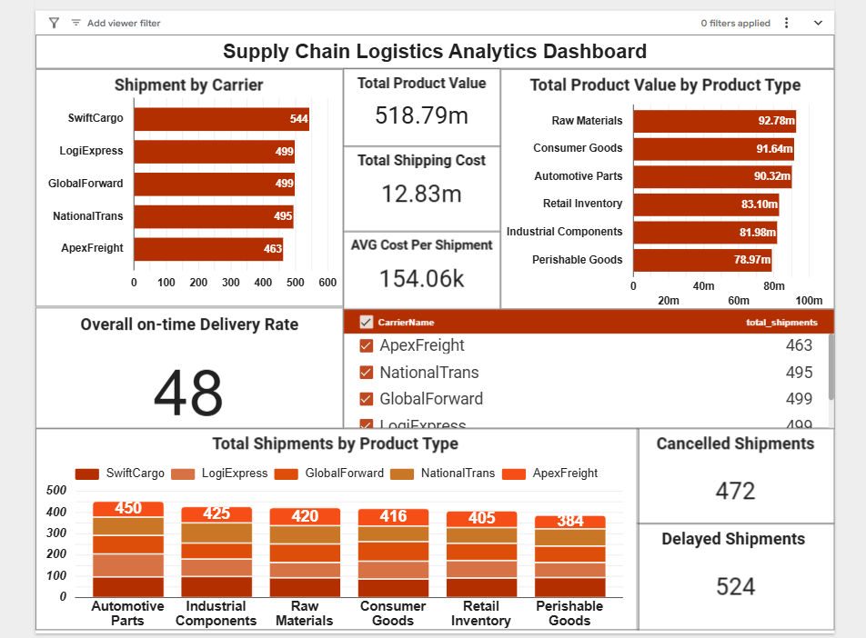

# 🚚 End-to-End Hybrid Supply Chain Analytics Pipeline (GCP + Python + SQL + Looker Studio)

An enterprise-grade, hybrid data engineering and business intelligence solution. This project showcases the ingestion, cleaning, transformation, and interactive visualization of **2,500+ records of supply chain logistics data** using an architecture designed to eliminate recurring cloud rendering costs.

---

## 📸 Dashboard Preview


---

## 🏗️ Project Architecture & Data Flow

The pipeline moves seamlessly across cloud and serverless components to build a scalable data loop:

1. **Cloud Ingestion:** Ingested the raw supply chain logistics repository (2.5k records) into a secure **GCP Cloud Storage Bucket** (`asia-south1` region).
2. **Data Cleansing (Python):** Created a serverless **BigQuery Studio Notebook** (Colab Enterprise). Leveraged **Python (Pandas)** to standardize temporal anomalies (e.g., handling missing delivery intervals) and filter metrics where freight costs were negative or skewed.
3. **KPI Warehousing (Standard SQL):** Engineered structural performance indicators within **BigQuery SQL**, grouping high-volume matrices by delivery channels and inventory classes.
4. **Cost-Free Deployment:** Migrated the processed dataset into a structured **Google Sheet** inside Google Drive to serve as a perpetual, lifetime-free data storage tier.
5. **BI Dashboarding (Looker Studio):** Built a highly responsive executive logistics dashboard using the zero-cost spreadsheet engine.

---

## 📊 Live Executive Dashboard Structure & KPIs

The finalized Looker Studio interactive dashboard displays the following production-ready insights:

- **Executive Core Metrics (Scorecards):** 
  - **Total Product Value (INR):** `518.79M` representing total inventory movement.
  - **Total Shipping Cost (INR):** `12.83M` summarizing macro logistics expenditure.
  - **AVG Cost Per Shipment:** `154.06k` evaluating financial transaction thickness.
- **Logistics & Carrier Performance:**
  - **Shipment by Carrier (Bar Chart):** Ranks fleet handling metrics (e.g., SwiftCargo at 544, LogiExpress at 499).
  - **Overall On-Time Delivery Rate:** A dynamic metric tracking promptness (Currently clocked at an index score of 48).
- **Inventory & Category Segmentation:**
  - **Total Product Value by Product Type (Horizontal Bars):** Maps capital thickness across categories like Raw Materials (`92.78m`), Consumer Goods (`91.84m`), and Automotive Parts (`90.32m`).
  - **Total Shipments by Product Type (Stacked Columns):** Tracks structural volumes across different cargo categories.
- **Supply Chain Exceptions & Health:**
  - **Fulfillment Red Flags:** Live trackers capturing critical pipeline leaks—**Cancelled Shipments (`472`)** and **Delayed Shipments (`524`)**.
  - **Interactive Controls:** Integrated a dynamic `CarrierName` multi-select checkbox filter to drill down performance in real-time.

---

## 💻 Technical Stack

- **Cloud Infrastructure:** Google Cloud Platform (GCP) - Cloud Storage, BigQuery Studio Notebooks
- **Data Engineering / Cleansing:** Python 3, Pandas Engine
- **Database Querying:** Google Standard SQL
- **Business Intelligence (BI):** Looker Studio, Google Sheets, Microsoft Excel

---

## 📁 Repository Structure

```text
├── data/
│   └── supply_chain_logistics_data.csv   # Cleaned dataset archive
├── scripts/
│   └── cloud_ingest_clean.py             # Python transformation pipeline
├── sql/
│   └── supply_chain_analytics.sql        # Standard SQL KPI business logic
├── .gitignore                            # Security rule filters for commits
└── README.md                             # Comprehensive project blueprint
```

---

## 🚀 Replicating the Workflow Locally

1. **Clone the repository:**
   ```bash
   git clone https://github.com
   ```
2. **Install core environment dependencies:**
   ```bash
   pip install pandas openpyxl
   ```
3. **Validation:** Review the analytical procedures mapped in the `sql/` directories to inspect how enterprise KPIs are created or run the `scripts/` stack to validate messy inventory streams locally.

---

## 🤝 Contact & Connect
If you have any questions about this project or would like to collaborate on data analytics initiatives, feel free to reach out!

- **👤 Name:** Manpreet Singh
- **📧 Gmail:** preetaulakh8756@gmail.com
- **🖥️ GitHub Profile:** [Preet-Aulakh](https://github.com)
